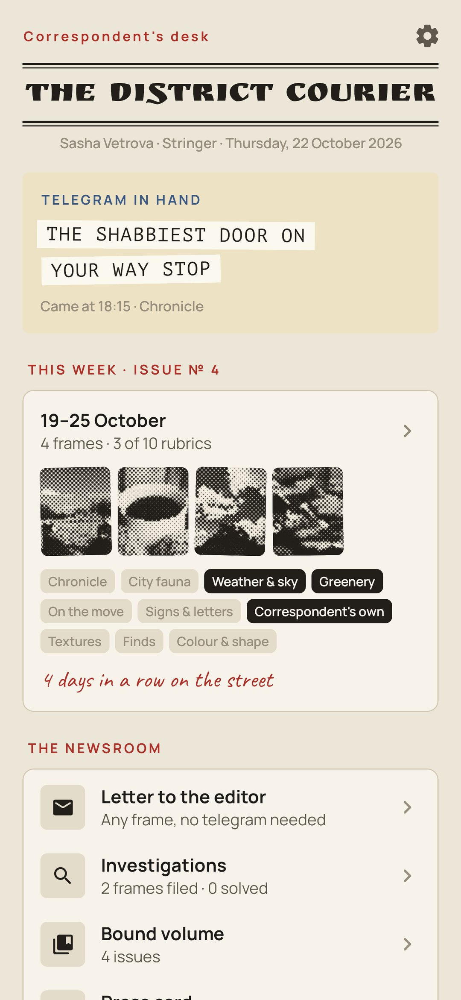
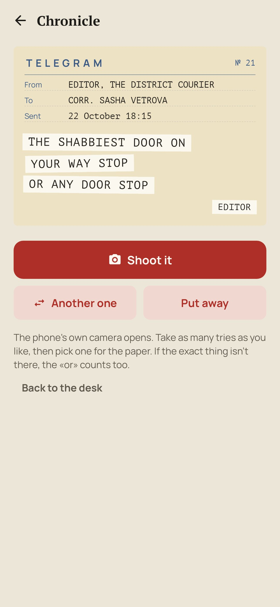
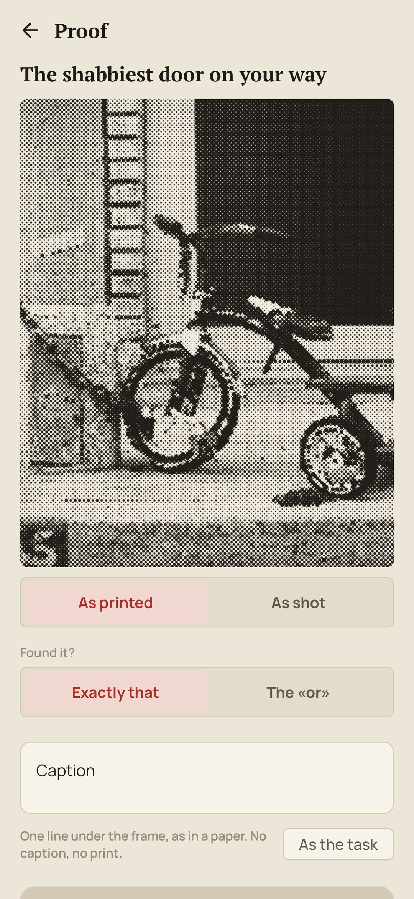
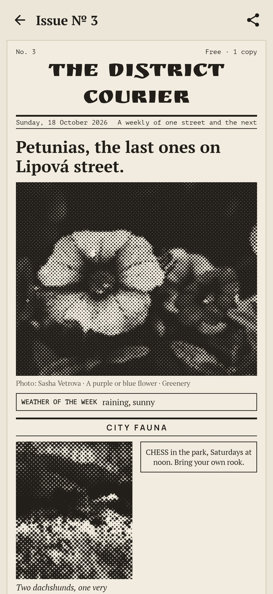
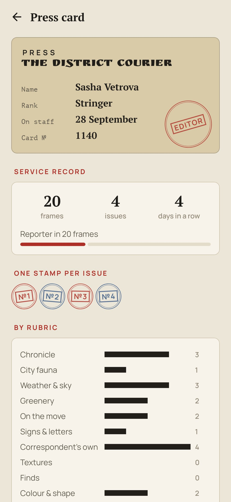

<div align="center">


# Stringer

### Every walk is an assignment from the district paper.

*Before you go out, the editor of a small district paper sends a telegram: one ordinary thing to shoot. A door, a pigeon, a puddle, a shadow, with a twist: from knee height, the shabbiest one on your way, with the sky in it. You shoot it with the phone's own camera, write one line under it, and it's printed as a newspaper halftone. On Sunday the week's frames come out as an issue. Free, no ads, no account, no internet.*

[](https://github.com/bigdevwhale/stringer/actions/workflows/android.yml)
[](https://github.com/bigdevwhale/stringer/releases/latest)


[](LICENSE)

**English** · [Русский](README.ru.md) · [Changelog](CHANGELOG.md)

    

</div>

---

## The idea

We walk the same streets every day and stop seeing them. A stringer, the freelance correspondent of a small paper, can't afford that: every walk has to bring back a frame. Stringer gives you that job. Nothing rare, nothing you have to travel for. Everything the editor asks for is on any street; the twist is what makes you look.

## How it works

1. **The telegram.** Going out? Tell the editor what it's like outside and ask for a telegram. It comes on a yellowish telegraph form, the task pasted on in strips of tape: «THE SHABBIEST DOOR ON YOUR WAY STOP OR ANY DOOR STOP».
2. **1271 assignments** in ten rubrics: Chronicle, City fauna, Weather & sky, Greenery, On the move, Signs & letters, the Correspondent's own, Textures, Finds, Colour & shape. That's three years of daily walks without a single repeat; a unit test walks all three years to make sure. The season, the weather you report and the evening light decide what can come: «a leaf on a car» in autumn, «drops on a window» in the rain, «a lit window» after dusk.
3. **The «or».** Every telegram carries a fallback. No cat in the window? Any cat. A walk never fails.
4. **One swap.** Not feeling it? Ask for another; the editor grumbles in red pencil and sends one more.
5. **The proof.** The phone's own camera opens. The frame comes back screened like newsprint, black dots on a 45° grid; «as shot» shows the original. Write a caption, one line as in a paper (no caption, no print), mark whether it was exactly that or the «or», and send it to press.
6. **The editor's mark.** Every filed frame gets a stamp and a line in the margin: «Set. To press.», «The «or» counts.», «Night shift. Approved.»
7. **The Sunday issue.** The week's frames are laid out as a newspaper page under your paper's masthead: the front-page photo with its caption as the headline, the rubrics two frames to a row, the week's weather in a box, small ads where a rubric is still empty. Share it as an image.
8. **Flash.** At dusk, with nothing in hand, a red «flash» comes in: the editor wants the evening light before it goes.
9. **Investigations** that take weeks: every letter of the alphabet on the district's signs, the digits 0–9, twelve doors, ten cats. Fill the slots in any order, whenever one turns up.
10. **The press card and the bound volume.** Ranks from trainee to chief of the district, a stamp for every issue, frames by rubric, and every issue so far, bound by year.
11. **Two papers.** The district weekly sends the plain twists; the big-city daily mixes in the trickier ones.

## Privacy

No account, no ads, no analytics, no internet permission, no camera permission. Frames are taken by the phone's own camera app and stay in the app's private files.

## Building

```bash
./gradlew testDebugUnitTest assembleDebug              # app.stringer.dev, next to a real install
./gradlew assembleDebug -Pdemo                         # app.stringer.demo, four weeks of a filled newsroom
./gradlew testDebugUnitTest -Prender --tests '*RenderArt*' && python tools/shots.py   # screenshots
python tools/icon.py                                   # the logo
python design/catalog/build.py                         # check the assignments and copy them into the app
```

Kotlin, Jetpack Compose, Room, DataStore. The halftone screen, the telegraph form and the newspaper page are drawn in code. The assignments live in `design/catalog/src/<rubric>.txt`, one per line: `thing|level|seasons|weather|time|en|ru`, with `{masc|fem}` where the Russian text depends on the correspondent's gender.

## License

[MIT](LICENSE). Fonts: Ruslan Display, PT Serif, PT Mono, Manrope and Caveat, all under the SIL Open Font License. The demo build's photos are from [Unsplash](https://unsplash.com) via [Lorem Picsum](https://picsum.photos) (authors in [docs/demo-credits.txt](docs/demo-credits.txt)), used under the Unsplash License, and ship only in the demo build.
