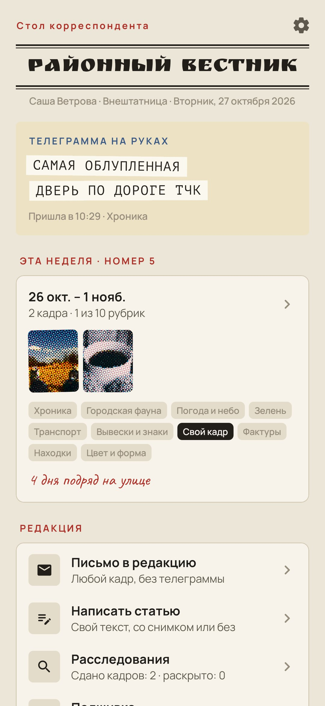
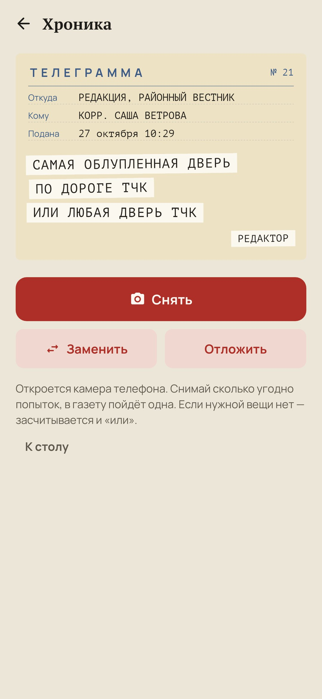
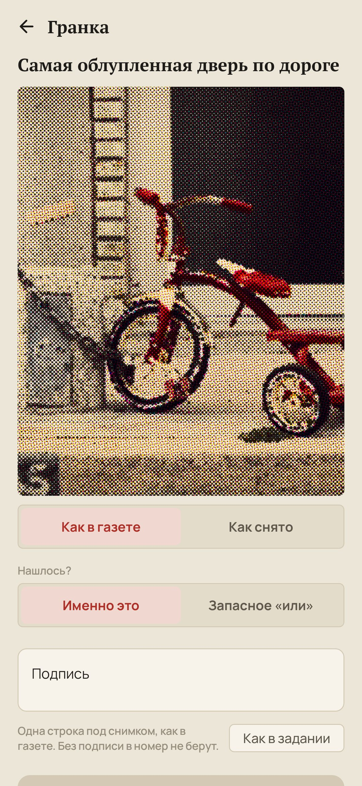
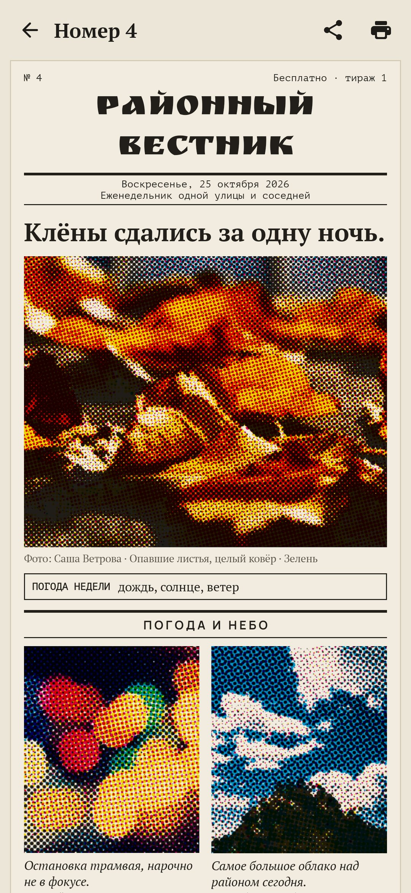
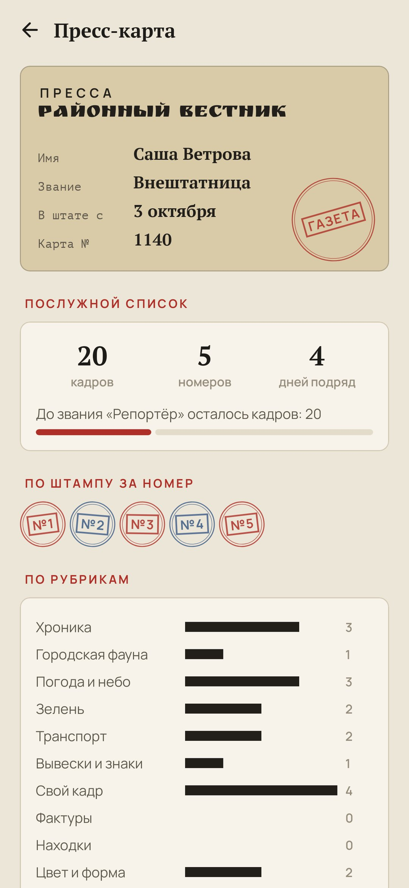

<div align="center">


# Внештатник

### Каждый выход на улицу — задание районной газеты.

*Перед прогулкой редактор маленькой районной газеты присылает телеграмму: одна обычная вещь, которую надо снять. Дверь, голубь, лужа, тень — но с изюминкой: с высоты колена, самая облупленная по пути, с небом в отражении. Снимаешь камерой телефона, подписываешь одной строкой, и кадр печатается газетным растром. По воскресеньям кадры недели выходят номером. Бесплатно, без рекламы, без аккаунта, без интернета.*

[](https://github.com/bigdevwhale/stringer/actions/workflows/android.yml)
[](https://github.com/bigdevwhale/stringer/releases/latest)


[](LICENSE)

[English](README.md) · **Русский** · [Изменения](CHANGELOG.md)

    

</div>

---

## Идея

Мы каждый день ходим по одним и тем же улицам и перестаём их видеть. Внештатный корреспондент маленькой газеты так не может: с каждой прогулки нужно принести кадр. Внештатник даёт тебе эту работу. Ничего редкого и ничего, за чем надо ехать. Всё, что просит редактор, есть на любой улице, а изюминка в задании заставляет присмотреться.

## Как это работает

1. **Телеграмма.** Выходишь? Скажи редактору, что за окном, и попроси телеграмму. Она приходит на желтоватом телеграфном бланке, задание наклеено полосками ленты: «САМАЯ ОБЛУПЛЕННАЯ ДВЕРЬ ПО ДОРОГЕ ТЧК ИЛИ ЛЮБАЯ ДВЕРЬ ТЧК».
2. **1271 задание** в десяти рубриках: Хроника, Городская фауна, Погода и небо, Зелень, Транспорт, Вывески и знаки, Свой кадр, Фактуры, Находки, Цвет и форма. Это три года ежедневных прогулок без единого повтора; тест проходит все три года и проверяет. Что придёт, решают сезон, погода, о которой ты сообщаешь, и вечерний свет: осенью «лист на машине», в дождь «капли на окне», после заката «окно, где уже зажгли свет».
3. **«Или».** В каждой телеграмме есть запасной вариант. Нет кота в окне — любой кот. Прогулка никогда не проваливается.
4. **Одна замена.** Не хочется? Попроси другое задание: редактор поворчит красным карандашом и пришлёт ещё одно.
5. **Гранка.** Открывается камера телефона. Кадр возвращается газетным растром: чёрные точки на сетке под 45° или, если выбрать цветную печать, точки в четыре краски; «Как снято» показывает оригинал. Можно и вовсе без растра — для всех снимков или для одного. Напиши подпись в одну строку, как в газете (без подписи в номер не берут), отметь, нашлось ли именно это или запасное «или», и отправляй в номер.
6. **Пометка редактора.** На каждом сданном кадре штамп и строчка на полях: «Годится. В номер.», «„Или“ засчитано.», «Ночная смена? В набор.»
7. **Воскресный номер.** Кадры недели вёрстаются газетной полосой под шапкой твоей газеты: снимок на первой полосе с подписью вместо заголовка, рубрики по два кадра в ряд, погода недели в рамке, объявления там, где рубрика пока пуста. Номер можно отправить картинкой или распечатать на принтере: страница сама разложится по листам A4, не разрезая снимков.
8. **Свои статьи.** Кроме кадров можно написать статью: заголовок, текст и снимок, если он есть. Статьи выходят в номере отдельной рубрикой.
9. **Молния.** В сумерках, когда на руках ничего нет, приходит красная «молния»: редакции нужен вечерний свет, пока он не ушёл.
10. **Расследования** на недели: все буквы алфавита на вывесках района, цифры 0–9, двенадцать дверей, десять котов. Ячейки заполняются в любом порядке — когда попадётся.
11. **Пресс-карта и подшивка.** Звания от стажёра до главного по району, штамп за каждый номер, кадры по рубрикам и все номера, переплетённые по годам.
12. **Две газеты.** Районная многотиражка присылает простые задания, столичный ежедневник подмешивает задания с подвохом.

## Приватность

Без аккаунта, рекламы и аналитики, без разрешений на интернет и на камеру. Кадры снимает приложение камеры телефона, и они остаются в личных файлах приложения.

## Сборка

```bash
./gradlew testDebugUnitTest assembleDebug              # app.stringer.dev, рядом с настоящей установкой
./gradlew assembleDebug -Pdemo                         # app.stringer.demo, четыре недели заполненной редакции
./gradlew testDebugUnitTest -Prender --tests '*RenderArt*' && python tools/shots.py   # скриншоты
python tools/icon.py                                   # логотип
python design/catalog/build.py                         # проверить задания и положить их в приложение
```

Kotlin, Jetpack Compose, Room, DataStore. Газетный растр, телеграфный бланк и полоса номера рисуются в коде. Задания лежат в `design/catalog/src/<рубрика>.txt`, по одному в строке: `thing|level|seasons|weather|time|en|ru`, с `{м|ж}` там, где русский текст зависит от рода корреспондента.

## Лицензия

[MIT](LICENSE). Шрифты: Ruslan Display, PT Serif, PT Mono, Manrope и Caveat — все под SIL Open Font License. Фотографии демо-сборки взяты с [Unsplash](https://unsplash.com) через [Lorem Picsum](https://picsum.photos) (авторы в [docs/demo-credits.txt](docs/demo-credits.txt)), используются по лицензии Unsplash и входят только в демо-сборку.
